# Controls

Every control the library supports: its settings, the values it sends to the Dash app, and what its callbacks receive when the app changes it. How a control looks is set by its settings in code, or by a layout made in the app ([layouts.md](layouts.md)).

## How controls work

- A control is identified by its **type** and **ID**. The ID is at most 7 characters, to keep messages short, and unique among the device's controls of that type. A longer ID raises `ValueError`, in code and in loaded layouts.
- Add each control to the device with `device.add_control(control)`. Controls in a loaded layout are created for you ([layouts.md](layouts.md#loading-layouts)).
- **Settings** are the constructor's parameters: the control's title, position, colours, range and so on. They go into the layout the device generates from its controls.
- **Values** are properties, such as `dial.dial_value`. Setting one sends it to every connected app. The device keeps the latest values, and sends them all when an app connects.
- **Numbers are sent to fit the control.** Dial and Table, which have a precision setting, send 6 significant digits, and the app shows them to the precision, which the user can change. Precision is the number of significant digits shown: 62.37 shows as 60 with `Precision.ONE`, 62 with `TWO` and 62.4 with `THREE`. Other controls send 5 significant digits.
- **Setting a value to `None` sends "not available"**: the app shows the control greyed out, e.g. when a sensor has failed. Dial, Direction, Knob and Slider also have `is_active`: `False` greys the control out, and setting a value makes it active again.
- When the user changes a control, the callbacks added with `add_receive_message_callback(callback)` are called with the message from the app, split on tabs: `msg[0]` is the device ID, `msg[1]` the control type, `msg[2]` the control ID, and `msg[3]` the value, as text. **Send the new value back from the callback**: that tells the app the device took the change, and shows it in every other app connected to the device. A callback can also return a string, which the device sends as a reply.

### Common settings

Most controls take these settings:

| Parameter | Default | |
|---|---|---|
| `control_id` | | The control's ID, up to 7 characters |
| `title` | Depends on the control | Shown with the control |
| `title_position` | `TitlePosition.BOTTOM` | `TOP`, `TOPLEFT`, `BOTTOM` or `NONE` |
| `control_position` | None | `ControlPosition(x, y, width, height)`: where it is on its DeviceView, as fractions of the DeviceView's width and height. Needed for the generated layout |

| Control method | |
|---|---|
| `add_receive_message_callback(callback)` | Calls `callback(msg)` when the app sends the control a message |
| `remove_receive_message_callback(callback)` | Stops calling it |
| `add_config(ControlConfig)` | Shows the control a second time in the generated layout, e.g. on another DeviceView, with its own title and position |
| `parent_id` | The DeviceView, Menu or ButtonGroup it's on. Set by their `add_control()` |
| `from_cfg_dict(cfg_dict)` | Creates the control from its entry in a decoded layout |

## Summary

| Control | Set its value | Its callbacks receive in `msg[3]` |
|---|---|---|
| [Button](#button) | `btn_state`, `text`, `icon_name`, `send_button()` | Nothing: a tap |
| [Knob](#knob) | `knob_value`, `knob_dial_value` | The knob's position |
| [Slider](#slider) | `slider_value`, `bar1_value`, `bar2_value` | The slider's position |
| [Selector](#selector) | `position`, `set_selected()`, `send_selection()` | The selected index, from 0 |
| [TextBox](#textbox) | `text`, `color`, `caption`, `caption_color` | The text the user entered |
| [ColorPicker](#colorpicker) | `color_value`, `send_color_rgb()` | The colour, e.g. `#23A89F` |
| [Dial](#dial) | `dial_value` | |
| [Direction](#direction) | `direction_value`, `direction_text` | |
| [TimeGraph](#time-graphs) | `add_data_point()` on its lines | |
| [EventLog](#event-logs) | `add_event_data()` | |
| [Map](#maps) | `add_location_to_track()` | |
| [Chart](#charts) | its lines' `data`, `send_chart()` | |
| [Table](#tables) | `add_table_row()`, `update_table_row()` | |
| [AudioVisualDisplay](#audiovisualdisplay) | `url` | |
| [Alarm](#alarms) | `send()` | |
| [Menu, ButtonGroup](#menu-and-buttongroup) | Nothing: they show other controls | Nothing: opened |
| [Label, DeviceView](#label-and-deviceview) | Nothing: layout only | |

## Input controls

### Button

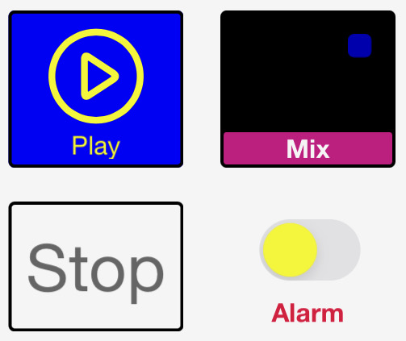

```python
pump = dashio.Button("pump", "Pump", control_position=dashio.ControlPosition(0.1, 0.1, 0.3, 0.2))
device.add_control(pump)


def pump_tapped(msg):
    pump.toggle_btn()


pump.add_receive_message_callback(pump_tapped)
pump.send_button(dashio.ButtonState.ON, dashio.Icon.PLAY, "Running")
```

- A tap doesn't change the button in the app. Your callback decides what a tap means, and sets the button's state to show it: the button is both an input and a status indicator.
- `btn_state` is `ButtonState.ON`, `OFF` or `FLASH`. `text` and `icon_name` change its text and icon. `send_button(btn_state, btn_icon, text)` sets all three. `toggle_btn()` switches between on and off.

| Parameter | Default | |
|---|---|---|
| `title` | `"A Button"` | |
| `button_enabled` | True | False stops the app sending taps |
| `style` | `ButtonStyle.BASIC` | Or `HIGHLIGHT` |
| `icon_name` | `Icon.NONE` | |
| `on_color`, `off_color` | `Color.BLUE`, `Color.RED` | |
| `text` | `""` | |

### Knob

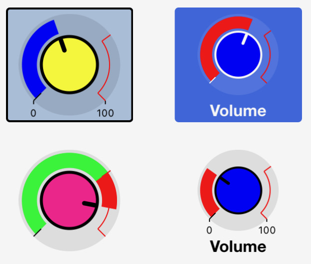

```python
volume = dashio.Knob("vol", "Volume", dial_max=10.0, control_position=dashio.ControlPosition(0.1, 0.4, 0.4, 0.3))
device.add_control(volume)


def volume_changed(msg):
    volume.knob_value = float(msg[3])


volume.add_receive_message_callback(volume_changed)
```

A knob the user turns, inside a dial. `knob_value` sets the knob, and `knob_dial_value` the dial, e.g. to show the value actually reached.

| Parameter | Default | |
|---|---|---|
| `title` | `"A Knob"` | |
| `knob_style` | `KnobStyle.NORMAL` | Or `PAN` |
| `dial_min`, `dial_max` | 0.0, 100.0 | The range |
| `red_value` | 75.0 | Where the dial turns red |
| `show_min_max` | False | |
| `send_only_on_release` | True | False sends values while the knob turns |
| `dial_mode` | `DialMode.FOLLOW` | The dial follows the knob. `MSG`: the dial only shows `knob_dial_value` |
| `dial_color`, `knob_color` | `Color.BLUE`, `Color.RED` | |

### Slider

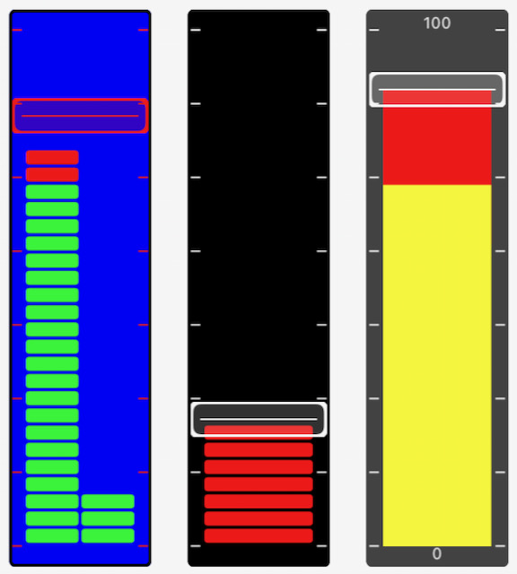

A slider the user moves, beside a bar the device sets. `slider_value` sets the slider, and `bar1_value` the bar, e.g. to show the value reached. Set `bar2_value` to show a second bar. With `slider_enabled=False` it's a bar graph the user can't move.

| Parameter | Default | |
|---|---|---|
| `title` | `"A Single Slider"` | |
| `bar_min`, `bar_max` | 0.0, 1000.0 | The range |
| `red_value` | 750 | Where the bar turns red |
| `show_min_max` | False | |
| `slider_enabled` | True | False hides the slider, leaving the bar |
| `send_only_on_release` | True | False sends values while the slider moves |
| `bar_mode` | `BarMode.FOLLOW` | The bar follows the slider. `MSG`: the bar only shows `bar1_value` |
| `bar_color`, `knob_color` | `Color.BLUE`, `Color.RED` | |
| `bar_style` | `SliderBarStyle.SEG` | Or `SOLID` |

### Selector

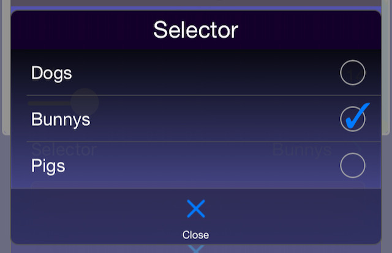

```python
mode = dashio.Selector("mode", "Mode", selection=["Off", "Auto", "On"], control_position=dashio.ControlPosition(0.1, 0.8, 0.4, 0.1))
device.add_control(mode)


def mode_selected(msg):
    mode.position = int(msg[3])


mode.add_receive_message_callback(mode_selected)
```

The user picks from a list. The app sends the index of the choice, and shows it as selected once the device sets `position`.

| Method or value | |
|---|---|
| `selection` (parameter) | The list of choices |
| `add_selection(text)` | Adds a choice, and returns its index |
| `position` | The selected index. Setting it sends it |
| `set_selected(text)` | Selects a choice by its text |
| `send_selection(position=None)` | Sends the list of choices, and optionally a new position |

### TextBox

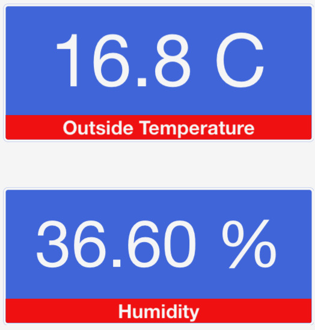

Shows text, a number or a date and time from the device, and lets the user enter text with the keyboard you choose. The app sends the text when the user taps Send.

- `text` sets the text, and `color` its colour (`Color.WHITE` until set). Setting either sends the text in its colour.
- `caption` and `caption_color` set the caption, a smaller line under the text. Setting either sends the caption, once there is one.
- When an app connects, the device sends the text and the caption, each in its colour.

| Parameter | Default | |
|---|---|---|
| `title` | `"A Text Box"` | |
| `text` | `""` | |
| `text_align` | `TextAlignment.LEFT` | Or `CENTER`, `RIGHT` |
| `text_format` | `TextFormat.NONE` | `NUM` formats a number, `DATETIME` and `DTLONG` an ISO 8601 date and time, `INTVL` an interval, `SUBS` substitutes text (see `replace`), or `LOG` |
| `units` | `""` | |
| `precision` | `Precision.OFF` | |
| `keyboard_type` | `Keyboard.ALL` | `NONE` (display only), `NUM`, `INT`, `HEX`, `DATE`, `TIME`, `DATETIME` or `INTVL` |
| `close_keyboard_on_send` | True | |
| `caption_mode` | `CaptionMode.MSG` | The caption shows `caption`. `SENT`: it shows the last text the user sent |
| `replace` | None | For `TextFormat.SUBS`: each key in the text is shown as its value, e.g. `{"0": "OK", "1": "Fault"}` |

### ColorPicker

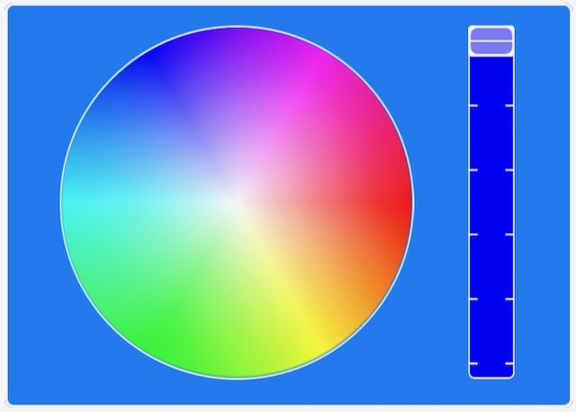

The user picks a colour, sent as `#RRGGBB`.

- `color_value` sets it, as `#RRGGBB`. `send_color_rgb(red, green, blue)` sets it from numbers, and `color_to_rgb("#23A89F")` returns `(35, 168, 159)`.

| Parameter | Default | |
|---|---|---|
| `title` | `"A Color Picker"` | |
| `style` | `ColorPickerStyle.WHEEL` | A colour wheel and brightness slider, or `SPECTRUM` |
| `send_only_on_release` | True | |

## Display controls

### Dial

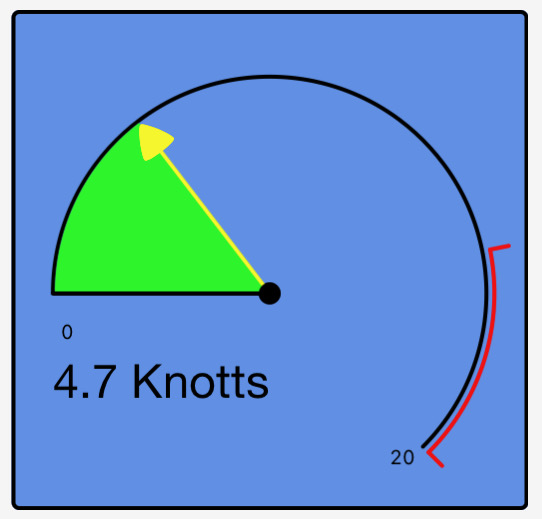

A number on a round dial: set `dial_value`.

| Parameter | Default | |
|---|---|---|
| `title` | `"A Dial"` | |
| `dial_min`, `dial_max` | 0.0, 100.0 | The range |
| `red_value` | 75.0 | Where the dial turns red |
| `dial_fill_color`, `pointer_color` | `Color.RED`, `Color.BLUE` | |
| `number_position` | `DialNumberPosition.LEFT` | `OFF`, `LEFT`, `RIGHT` or `CENTER` |
| `show_min_max` | False | |
| `style` | `DialStyle.PIE` | `PIE`, `PIEINV` or `BAR` |
| `precision` | `Precision.OFF` | |
| `units` | `""` | |

### Direction

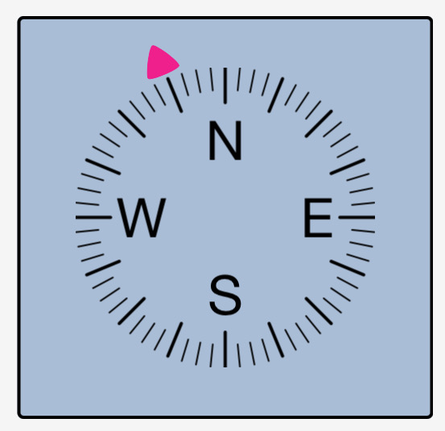

A direction from 0 to 360 degrees: set `direction_value`, and `direction_text` for text under it.

| Parameter | Default | |
|---|---|---|
| `title` | `"A Control"` | |
| `style` | `DirectionStyle.DEG` | `NSEW`, `DEG` or `DEGPS` |
| `pointer_color` | `Color.GREEN` | |
| `units` | `""` | |
| `precision` | `Precision.OFF` | |
| `calibration_angle` | 0 | The calibration angle offset |

### AudioVisualDisplay


Plays or shows what's at a URL: an image, or an audio or video stream. Set `url`. Its default title is `"A Audio visual display"`.

## Time graphs

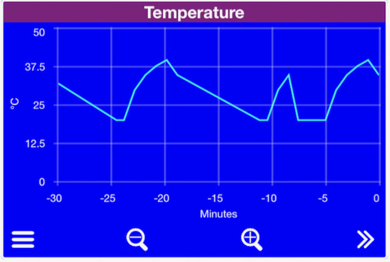

Values over time, in lines the user can pan and zoom. Each line is a `TimeGraphLine`, added to the graph with an ID:

```python
graph = dashio.TimeGraph("tg1", "Climate", y_axis_label="°C", y_axis_max=40.0, control_position=dashio.ControlPosition(0.0, 0.5, 1.0, 0.4))
graph.add_line("temp", dashio.TimeGraphLine("Temperature", color=dashio.Color.RED))
graph.add_line("both", dashio.TimeGraphLine(["Inside", "Outside"], color=None))
device.add_control(graph)

graph.line_dict["temp"].add_data_point(21.5)
graph.line_dict["both"].add_data_point([21.5, 14.0])  # A line of arrays
```

- `add_data_point(value)` adds a value, stamped with the current time, and sends it. A value is an int, float, bool or numeric string, or a list for a line of arrays (several values at each time, e.g. a min, mean and max).
- `add_break()` adds a gap to the line.
- The app asks for the points since the last one it has, so it fills in what it missed. They come from each line's ring buffer, from a [DashStore](storage.md), or from the Dash server with `storage_enable()` ([storage.md](storage.md)).
- `graph.delete_history(line_id=None)` deletes a line's points, or every line's, on the device and the Dash server ([storage.md](storage.md#starting-a-line-again)).

| TimeGraphLine parameter | Default | |
|---|---|---|
| `name` | `""` | A list of names for a line of arrays, e.g. `["Inside", "Outside"]` |
| `line_type` | `TimeGraphLineType.LINE` | `LINE`, `BAR` or `BOOL` |
| `color` | `Color.BLACK` | None lets the app choose, e.g. for a line of arrays |
| `max_data_points` | 60 | The size of the line's ring buffer |
| `break_data` | False | Shows a break where data is missing |
| `right_axis` | False | Plots against the right axis |

| TimeGraph parameter | Default | |
|---|---|---|
| `title` | `"A TimeGraph"` | |
| `y_axis_label` | `"Y axis"` | |
| `y_axis_min`, `y_axis_max` | 0.0, 1000.0 | |
| `y_axis_num_bars` | 5 | Grid lines |
| `y_axis_label_rt`, `y_axis_min_rt`, `y_axis_max_rt` | `""`, 0.0, 1000.0 | The right axis |

## Event logs

A list of events, each with a time, a colour and lines of text. The newest is shown on the control, and the user taps it for the list.

```python
log = dashio.EventLog("log1", "Events", control_position=dashio.ControlPosition(0.0, 0.0, 1.0, 0.2))
device.add_control(log)

log.add_event_data(dashio.EventData("Pump started\nTank at 40%", dashio.Color.GREEN))
```

- `EventData(lines, color=Color.WHITE)`: up to 25 lines of text, separated by `\n`, stamped with the current time.
- `add_event_data(event)` adds it to the log and sends it. `send_event(event)` sends it without adding it, and `send_latest_data()` sends the newest again.
- The app asks for the events since the last one it has. They come from the log's ring buffer (`max_log_entries`, default 100), from a [DashStore](storage.md), or from the Dash server with `storage_enable()`.
- `delete_history()` deletes the entries on the device and the Dash server ([storage.md](storage.md#starting-a-line-again)).
- Several devices can show events in one EventLog.

## Maps

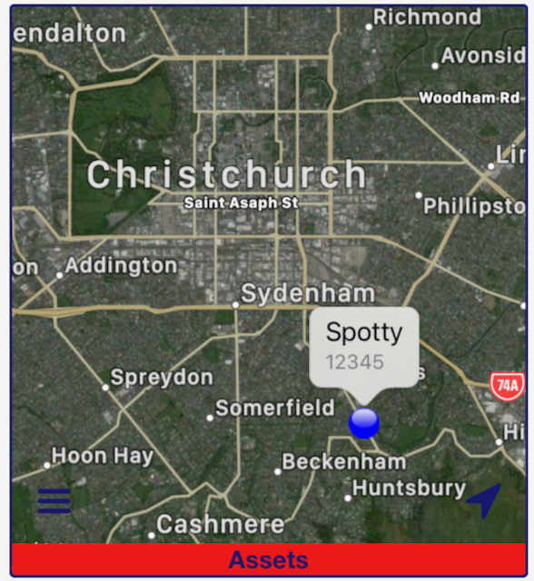

Locations on a map, in tracks. Each track has an ID, a name and a colour. A track is made the first time a location is added to it, or added with `add_track()` to give it a name and colour:

```python
fleet = dashio.Map("map1", "Fleet", control_position=dashio.ControlPosition(0.0, 0.0, 1.0, 0.5))
device.add_control(fleet)
fleet.add_track(dashio.MapTrack("trip", "Today's trip", dashio.Color.BLUE))
fleet.add_track(dashio.MapTrack("pos", "Truck 1", dashio.Color.RED, replace=True))

fleet.add_location_to_track(dashio.MapLocation("-43.580024", "172.652574", altitude="184.2"), "trip")
fleet.add_location_to_track(dashio.MapLocation("-43.580024", "172.652574"), "pos")
```

- `MapLocation(latitude, longitude, average_speed=None, peak_speed=None, course=None, altitude=None, distance=None)`, stamped with the current time. Give the values as strings.
- `MapTrack(track_id, text="", color=Color.RED, replace=False)`. With `replace=True` it's a "where it is now" marker: the Dash server keeps only its latest location, not a track log.
- `add_location_to_track(location, track_id)` adds a location and sends it. `send_location(location, track_id="")` sends one without adding it.
- `delete_history(track_id=None)` deletes a track's locations, or every track's, on the device and the Dash server ([storage.md](storage.md#starting-a-line-again)).
- Several devices can show tracks on one Map. Its default title is `"A Map"`.

## Charts

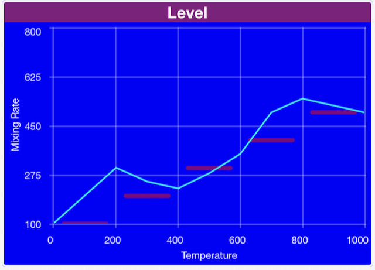

Lines or bars of values, evenly spaced along the X axis. Each line is a `ChartLine`, added with an ID:

```python
chart = dashio.Chart("chart1", "Spectrum", y_axis_max=100.0, control_position=dashio.ControlPosition(0.0, 0.0, 1.0, 0.4))
line = dashio.ChartLine("Level", dashio.ChartLineType.BAR, color=dashio.Color.BLUE)
chart.add_line("level", line)
device.add_control(chart)

line.data = [12, 40, 87, 55, 23]
chart.send_chart()
```

| ChartLine parameter | Default | |
|---|---|---|
| `name` | `""` | |
| `line_type` | `ChartLineType.LINE` | `LINE`, `BAR`, `SEGBAR` or `PEAKBAR`. `DELETE` removes the line from the chart |
| `color` | `Color.BLACK` | |
| `right_axis` | False | |

| Chart parameter | Default | |
|---|---|---|
| `title` | `"A Chart"` | |
| `x_axis_label`, `x_axis_min`, `x_axis_max` | `""`, 0.0, 100.0 | |
| `x_axis_num_bars` | 5 | |
| `x_axis_labels_style` | `ChartXAxisLabelsStyle.ON` | Or `BETWEEN` |
| `y_axis_label`, `y_axis_min`, `y_axis_max` | `""`, 0.0, 1000.0 | |
| `y_axis_num_bars` | 5 | |
| `y_axis_label_rt`, `y_axis_min_rt`, `y_axis_max_rt` | `""`, 0.0, 1000.0 | The right axis |

## Tables

Rows of values, each with a label, and an optional row of headings.

```python
table = dashio.Table("tbl1", "Tanks", columns=3, column_headings=["Tank", "Level", "Temp"], control_position=dashio.ControlPosition(0.0, 0.0, 1.0, 0.3))
device.add_control(table)

table.add_table_row(dashio.TableRow("North", [82, 14.5]))
table.update_table_row(dashio.TableRow("North", [80, 14.6]), 0)
```

- `TableRow(label=None, columns=None, units=None)`: the columns can be text or numbers.
- `add_table_row(row)` adds and sends a row. `update_table_row(row, row_number)` replaces a row, or adds it if there isn't one, and returns its index. `clear_row(row_number)` and `clear_table()` clear them.

| Parameter | Default | |
|---|---|---|
| `title` | `"A Table Box"` | |
| `precision` | `Precision.OFF` | |
| `font_size` | 12 | |
| `label_width_percent` | 50 | |
| `columns` | 2 | Columns, including the label |
| `column_headings` | None | |

## Alarms

```python
alarm = dashio.Alarm("hiTemp")
device.add_control(alarm)
alarm.send("High temperature", "The greenhouse is at 35°C")
```

`send(header, body)` sends a notification to the phones registered to your Dash account, through the Dash server, so it needs a [DashConnection](connections.md#dashconnection). Which phones get it, and its sound, are set in the app. An Alarm isn't part of a layout.

## Containers and views

### Menu and ButtonGroup

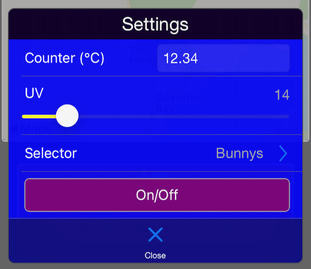 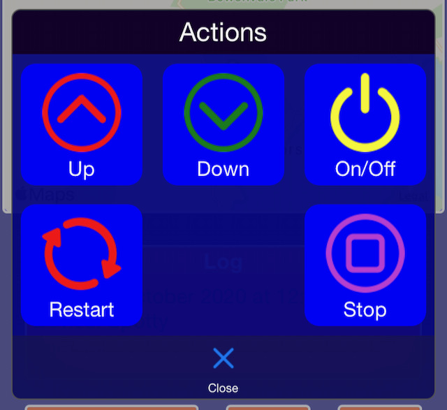

A Menu shows a popup list of TextBoxes, Sliders, Selectors and Buttons, added with `add_control()`. A ButtonGroup shows a popup grid of Buttons, added with `add_button()`. The controls in them work as they do anywhere else, and their values are sent when the user opens the Menu or ButtonGroup. A Menu can also go in the app's provisioning menu. See [layouts.md](layouts.md#menus-buttongroups-and-the-provisioning-menu).

| Menu parameter | Default | |
|---|---|---|
| `title` | `"A Menu"` | |
| `text` | `"A Menu with Text"` | |
| `style` | `MenuStyle.BASIC` | Or `HIGHLIGHT` |
| `icon_name` | `Icon.MENU` | |

| ButtonGroup parameter | Default | |
|---|---|---|
| `title` | `"A Button Group"` | |
| `text` | `"A Button group with Text"` | |
| `style` | `ButtonGroupStyle.BASIC` | Or `HIGHLIGHT` |
| `icon` | `Icon.MENU` | |
| `grid_view` | True | False shows a list |

### Label and DeviceView

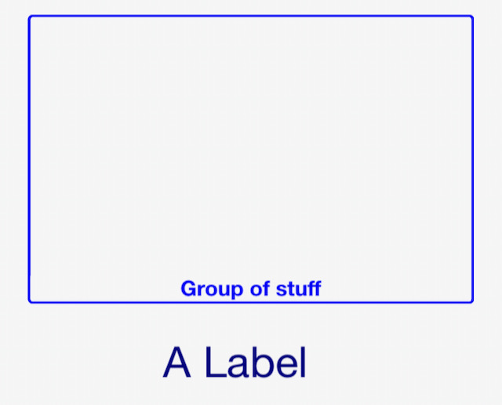

A **Label** gives a layout structure: a heading, a box or a fill. Its parameters are `title` (default `"A label"`), `color` (`Color.WHITE`) and `style` (`LabelStyle.BASIC`, `GROUP`, `BORDER` or `FILL`).

A **DeviceView** is a screen of controls in the app. Add controls to it with `add_control()`, and add it to the device. Its settings are the defaults for the controls on it:

| Parameter | Default | |
|---|---|---|
| `title` | `"A DeviceView"` | |
| `style` | `DeviceViewStyle.BASIC` | Or `BORDERS` |
| `icon` | `Icon.SQUARE` | |
| `color` | `Color.BLACK` | |
| `share_column` | True | Another DeviceView can share the column, if there's room |
| `num_columns` | 1 | How many columns wide it is, 1 to 3 |
| `control_title_box_color`, `control_title_box_transparency` | `Color.BLACK`, 0 | |
| `control_color`, `control_border_color` | `Color.WHITE_SMOKE` | |
| `control_background_color`, `control_background_transparency` | `Color.BLACK`, 0 | |
| `control_title_font_size`, `control_max_font_size` | 16, 20 | |
| `num_grid_columns`, `num_grid_rows` | 22, 32 | The grid in the app's layout editor |
| `user_tappable_color` | `""` | The colour of what the user can tap, e.g. a time graph's buttons or a Menu's icon. Unset, the control colour |

## Colours and icons

`Color` names the app's colours, e.g. `Color.RED`, `Color.SEA_GREEN`. Settings that take a colour also take a hex string such as `"#23A89F"`. `Icon` names the app's icons, e.g. `Icon.PLAY`, `Icon.LIGHT_BULB`. Their full lists are in `dashio/iotcontrol/enums.py`.
